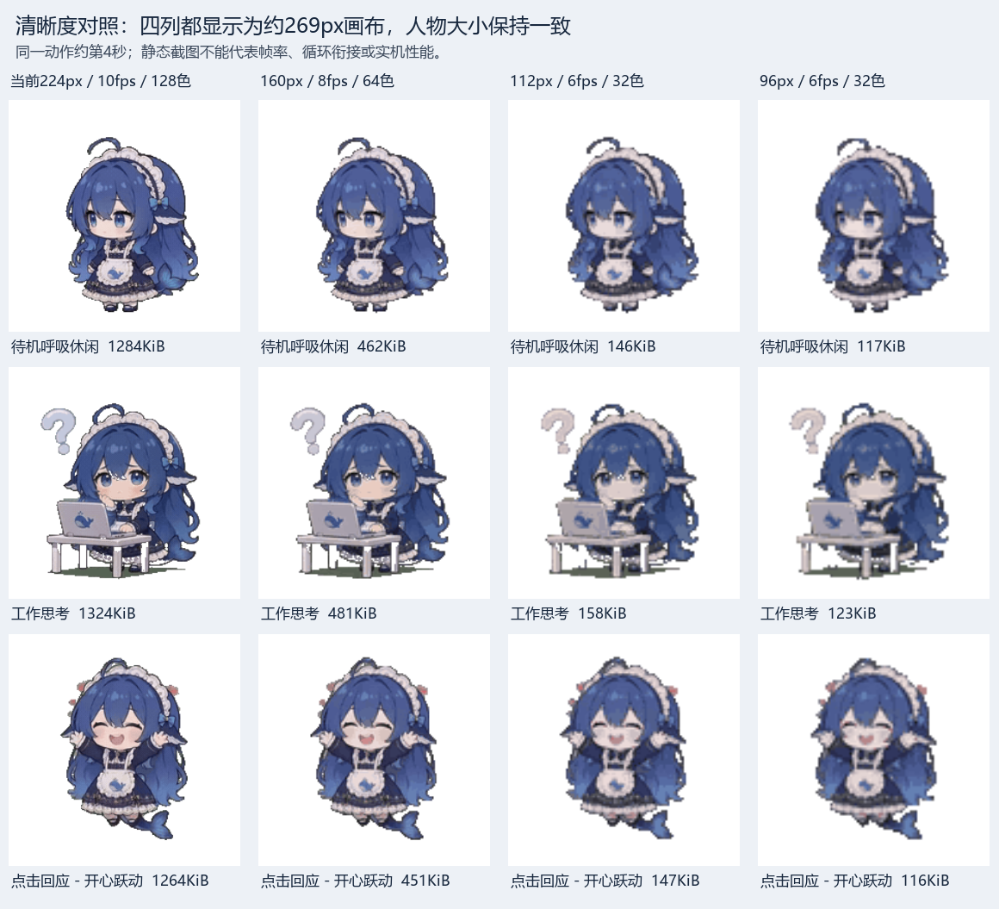

# 动画容量实验：全库能放下，但清晰度需要取舍

记录时间：2026-10-22T12:23:26+09:00。工具：FFmpeg 8.1.1、Pillow 12.2.0。当前设备仍是已通过验证的 v3 放大版，三种 224px 动画未改动。

## 本轮结论

已在电脑上转换全部50项，96×96、6fps、32色GIF的离线资源包为 **8,952,113字节（8.54MiB）**，现有10MiB资源区剩余 **1,533,647字节（14.63%）**。包括原有字体、语音模型和PNG；这些保留资源逐字节不变。包的SHA256为 `cc9a0318500a958f13621e1023c8e724afba9b69a2e1823d0f1a41ba49bbb33d`。

这只证明编码后的全库容量能放下，尚未证明显示质量、播放性能、切换、触摸和语音共存通过。50项已转换，不等于50项已适配。源素材约10.042秒；本档输出每项60帧、约10秒，未靠截取两三秒来缩小。

保持人物现在的显示大小时，96px素材需要放大到约269px画布，头发、眼睛和衣服细节明显变糊，6fps也低于当前10fps。对照图使用同一动作约第4秒、同样269px显示画布；电脑上的双线性放大仅供清晰度比较，不代表LVGL最终缩放效果。不能只替换资源就声称人物大小不变：现有固件仍按224px/307缩放，低分辨率版需同步调整显示比例和命中区域。

建议先用160px、8fps、64色适配常用10项，保留低清全库包作另一种选择。160px方案同样需调整显示比例才能保持现在的“大一圈”；它也低于当前素材质量，仍需用户和实机确认。

## 实测结果

| 实验 | 测量范围 | 结果 | 意义 |
| --- | --- | --- | --- |
| 224px/8fps/64色，无抖动 | 待机、思考、开心 | 每项约0.84–0.89MB | 与有抖动版本接近，关抖动不足以解决容量。 |
| 224px/8fps/32色 | 同上 | 每项约0.65–0.70MB | 仍远超全库平均预算。 |
| 索引帧差分加zlib | 同上 | 每项约0.47–0.68MB | 只对该量化输入验证了差分可逆；不足以支持新增解码器。 |
| 112px/6fps/32色 | 全部50项 | GIF合计7,592,517字节 | 加现有非GIF资源已经超过10MiB。 |
| 96px/6fps/32色 | 全部50项 | GIF合计5,963,415字节 | 完整离线包8,952,113字节，符合至少10%余量的预算。 |
| 160px/8fps/64色 | 暂选常用10项 | GIF合计4,684,340字节（4.47MiB） | 加原有非GIF资源约7.31MiB，尚未生成这档完整包，表项与索引另有少量开销。 |

常用10项暂选：W001东张西望、W006小憩沉眠、W019工作思考、W024待机呼吸、W027打盹被唤醒、W029傲娇生气、W030害羞、W031开心、W035叹气、W043吓一跳。用途仍需完整动作审阅后确定；不把生活动作硬套为情绪。

## 本轮已验证与尚未验证

- 已验证50个源文件SHA256、转换文件尺寸和帧数、逐帧可解码及透明通道、候选包打包/解包逐字节一致、索引引用存在、字体/模型/原PNG原样保留、资源区及10%余量限制。
- 三个代表动作没有完全相同的相邻GIF帧；删除重复帧在这些样本上没有收益。不能据此声称全库没有视觉重复。
- 已查看三个代表动作同一时刻的清晰度对照。全50项完整运动及视觉质量、循环衔接、实际帧率、内存、触摸、语音、稳定性均待验证。
- 未修改启动程序、分区表、应用或设备资源；未删除当前动画；未将私人备份或日志提交Git。
- 离线低清包只保存在原电脑容量实验目录，文件名带 `EXPERIMENTAL-NOT-INSTALLED`；Git保存脚本、测量数据、清单和对照图，不添加这一轮100个候选GIF或重复大包。

## 复现

仓库根目录执行，需FFmpeg（含libvpx-vp9）和Pillow。使用本地忽略目录保存候选文件；这些命令均不访问设备。

```sh
python scripts/whale/benchmark_whale_resolution.py --source whale/source --output local-only/full-library-budget --sizes 112 96 --fps 6 --colors 32 --all
python scripts/whale/pack_whale_capacity_candidate.py --repo . --candidates local-only/full-library-budget --output local-only/full-library-candidate
python scripts/whale/benchmark_whale_resolution.py --source whale/source --output local-only/common-ten --sizes 160 --fps 8 --colors 64 --library whale/library.json --ids W001 W006 W019 W024 W027 W029 W030 W031 W035 W043
```

编码器版本可能改变输出字节及哈希；每次按实际大小重新检查预算。当前正式构建工具仍固定使用已验证的三种224px素材，不会自动选用实验候选。

## 下一步怎样验收

先确定清晰度与数量的优先级，再构建保持当前人物显示大小的独立试验版。先用三个动作验证清晰度、流畅度、10次触摸和至少3轮语音；通过后再接动作选择入口、逐项播放与情绪/状态规则。低清50项方案若被选择，也必须逐项实机验证，不能因为包能放下便记为全库完成。


