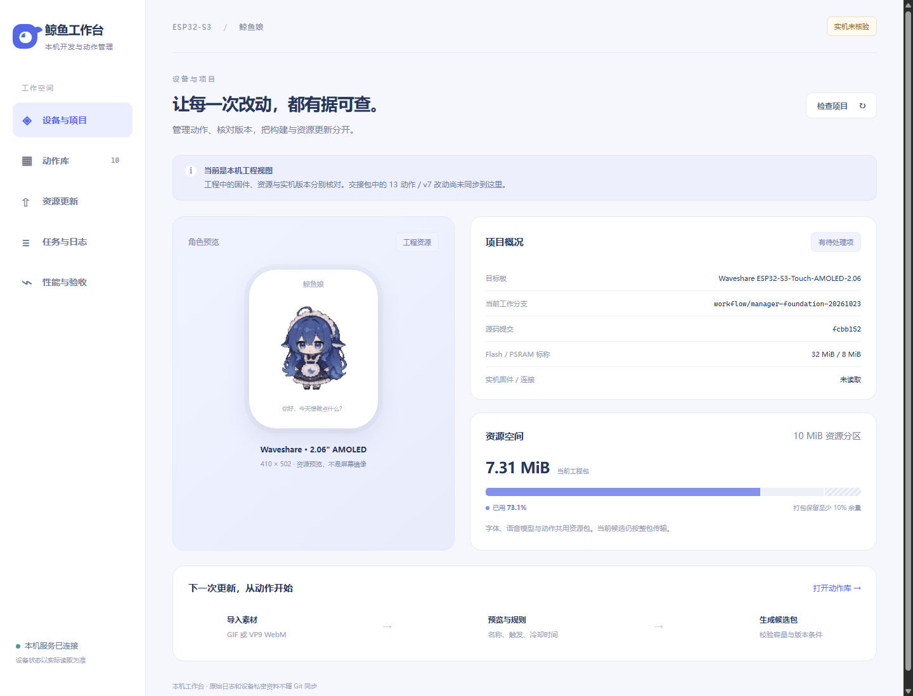
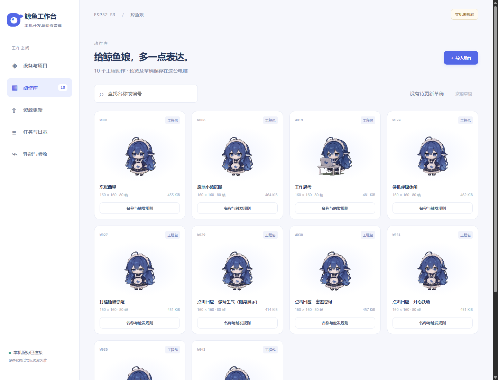

# 鲸鱼工作台：本轮交付与验收

本轮完成主机端基础建设：统一执行器、动作资源管理、本机网页工作台。设备端动态动作引擎、安装通道和实机验收仍未完成。

## 如何使用

打开 http://127.0.0.1:8765 。本轮结束时服务保持运行；电脑重启后，在仓库根目录执行 `python scripts/whale/manager.py` 重新启动。

仓库：https://github.com/miland927/chinchin-esp32 。

工作分支：`workflow/manager-foundation-20261023`；基线提交：`fcbb152fbf4a4b9a7f0133b450c812341c5d4c81`。本轮不合并 main。

## 已完成

| 项目 | 可验证结果 |
|---|---|
| 统一命令 | check、test、assets、package、受条件限制的 build，共用任务记录、日志与工作树锁 |
| 任务控制 | 开始/结束时间、阶段耗时、限量摘要、取消、超时、子进程回收 |
| 动作库 | 10 种现有素材预览；GIF/WebM 导入；转换缓存；替换媒体与规则草稿 |
| 资源候选 | 确定性打包、结构和哈希校验、容量余量检查，保留字体与模型 |
| 本机面板 | 项目、动作库、候选、任务、性能与验收页面；手机宽度可用 |
| 保护措施 | 本机监听、同源校验、请求令牌、素材访问 Cookie、路径与输入校验 |

替换现有媒体可在电脑生成无需重新编译应用的候选，但尚未安装到设备。新增菜单和规则会标识需要引擎升级。差异 ZIP 明确不是可安装的增量包。

## 验收证据

- 最终统一测试：140 项，133 项通过、7 项跳过，返回码 0，主机耗时 26.39 秒。跳过项为既有 Linux/原生 C++ 环境相关项目。
- 实际 Chrome 验证通过 8 项：10 个真实素材预览、GIF 替换导入、仅媒体候选生成、规则草稿、标签防 HTML 注入、撤销草稿、过期候选识别、手机无横向溢出。无页面控制台异常。
- 离线工程检查与资源检查通过。缺少已激活 SDK、缺少最新 v7 配置被明确报告。
- 已确认 `main`、`partitions`、`whale/assets.bin`、`dependencies.lock` 无本轮修改。没有编译或写入设备固件，没有访问串口或重启设备。
- 资源原件：7,669,838 字节；SHA-256：`e11afaa6e30672eaa1aa90e9e0141a53bc2ff76797d92899eff0978087b0f147`。

## 剩余接入顺序

1. 获取另一台电脑上最新 13 动作/v7 完整源码，核对配置和临时语音探针。
2. 设备改为加载动作清单、动态生成菜单和情绪规则，解除新增动作对应用编译的依赖。
3. 接入独立资源更新、完整性校验、断电恢复和版本回退，完成一次实机闭环。
4. 再做按文件增量更新、实时性能指标、断网/损坏/容量不足验收。

设备 CPU、内存和 FPS 本轮未测。锁与预算目前只覆盖新执行器，不自动约束旧私有脚本。主机测试通过不能代替设备验收。

使用说明见 [HOST_MANAGER.md](HOST_MANAGER.md)。完整路线和执行时间另存于本地交付目录。

